  

###

<h1 data-importer="text" align="left">🧑‍💻 Sobre mim</h1>

###

  Sou estudante de Análise e Desenvolvimento de Sistemas, formado como Técnico em Desenvolvimento de Sistemas pelo SENAI. Busco aprimorar meus conhecimentos em dados e me desenvolver profissionalmente.
  
   
  
  💻 Desenvolvendo projetos pessoais e acadêmicos  
  📊 Dados: Explorando análise e manipulação de dados com Pandas, SQL e ferramentas de BI

---

###

<h2 data-importer="text" align="left">💻 Tecnologias que utilizo</h2>

  
  
  
  
  
  
  
  
  
  
  
  
  
  
  
  
  

###

<picture data-importer="pacman">
  <source media="(prefers-color-scheme: dark)" srcset="https://raw.githubusercontent.com/giovanni789silva/giovanni789silva/pacman-output/pacman-contribution-graph-dark.svg?game=pacman">
  <source media="(prefers-color-scheme: light)" srcset="https://raw.githubusercontent.com/giovanni789silva/giovanni789silva/pacman-output/pacman-contribution-graph.svg?game=pacman">
  
</picture>

###
